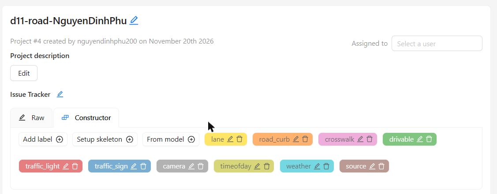
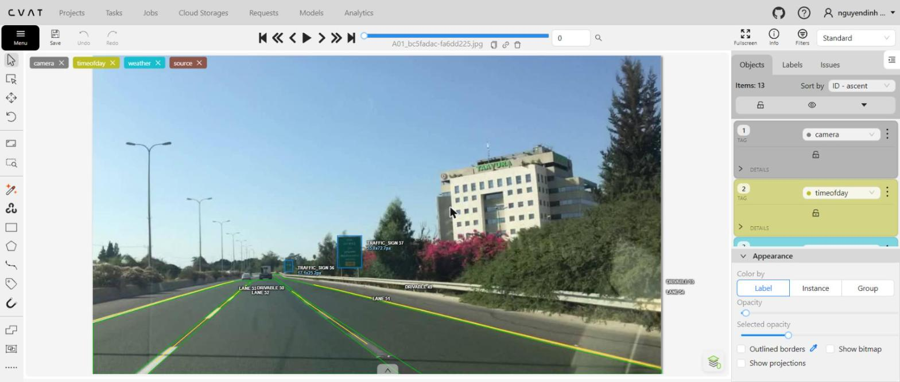
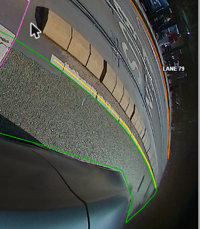
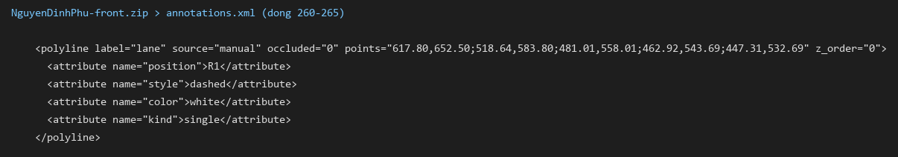

# Báo cáo cá nhân — Ngày 11
Họ tên: Nguyễn Đình Phú               Mã học viên: 2A202603333  
Phiên bản CVAT (Help → About): 2.81.0  
Guideline: Road v1.0    Lần nộp (`revision` trong manifest): 1  
Thời điểm export (ngày giờ trên CVAT): 21/11/2026 10:34 (UTC+7)    Số lần nộp lại sau Rework: 0

## 1. Kiểm project
| Mục | Đúng như guideline Road v1.0? | Ghi chú |
| --- | --- | --- |
| 6 label, đúng kiểu | Đúng | `lane`, `road_curb` (polyline); `crosswalk`, `drivable` (polygon); `traffic_light`, `traffic_sign` (rectangle) |
| Thuộc tính và giá trị | Đúng | Tạo bằng tab Raw từ `configs/road_v1_labels.json`; `edge_zone` là checkbox |
| 4 tag ảnh | Đúng | `camera`, `timeofday`, `weather`, `source`, mỗi tag một thuộc tính select `value` |

Cách kết thúc polyline trên bản CVAT này: phím **N** (hoặc double-click điểm cuối).  
Cách đặt tag ảnh trên bản CVAT này: công cụ **Tag** ở thanh trái → chọn label → **Tag**; giá trị sửa trong **Details** của bảng Objects (mặc định là giá trị đầu danh sách).

## 2. Số lượng đã gán
| Task | Ảnh | lane | road_curb | crosswalk | drivable | traffic_light | traffic_sign |
| --- | ---: | ---: | ---: | ---: | ---: | ---: | ---: |
| front | 12 | 27 | 15 | 8 | 21 | 45 | 49 |
| front-extra (đã làm 4 / 4) | 4 | 10 | 3 | 2 | 7 | 12 | 19 |
| fisheye | 8 | 9 | 17 | 11 | 11 | 7 | 9 |
| fisheye-extra (đã làm 4 / 4) | 4 | 0 | 3 | 3 | 7 | 1 | 0 |

## 3. Bảng ca khó
| Ảnh | Nhãn | Phân vân giữa | Đã chọn | Lý do |
| --- | --- | --- | --- | --- |
| A01 | lane L2 (sát lề trái) | `single` / `double` | `double` | Phóng to đoạn gần xe thấy hai nét trắng song song |
| A03, A05, A06, A09, A14 | lane L1/R1 | vẽ vạch / để trống | để trống | Không xác định được vạch sơn sát làn đang đi; lint báo QC1-02, chờ coach xác nhận. Riêng A03 người kiểm cho là có vạch vàng |
| A08 | lane L1 | `L1` / `L2` | `L1` | Sau giao lộ, vạch đầu tiên thấy được bên trái làn đang đi nằm cách xa; đếm theo quy tắc "vạch đầu tiên bên trái" |
| A08, A10, A11 | traffic_light (đèn đi bộ) | màu cam / trắng → giá trị nào | "dừng" = `red`, "đi" = `green` | Danh sách `color` không có cam/trắng; ánh xạ theo nghĩa tín hiệu |
| A10 | drivable làn "ONLY" | `alternative` / không gán | không gán | Làn dành riêng cho xe buýt, xe không được chuyển sang |
| A13, A14 | vạch sơn sát lề | `road_curb` / `lane` | `lane` (A13) | Guideline: `road_curb` chỉ dùng cho mép không sơn; vạch có sơn là `lane` |
| B03, B04 | position ở camera đuôi | trái/phải theo xe / theo ảnh | theo ảnh | Guideline không quy định riêng cho `fisheye_rear` |
| B03, B08, B12 | lane fisheye ít vệt | thêm điểm theo cung / mỗi vệt một điểm | mỗi vệt một điểm ở tâm | Chỉ đặt điểm trên sơn thấy được; cảnh báo QC1-11 của lint chỉ là gợi ý |
| B11 | vạch ô đỗ | `lane` / không gán | không gán | Guideline mục 4: vạch ô đỗ không gán lane; chỉ gán vùng lái lối đi |

## 4. Phiếu QC 1 nhận được
Người kiểm lô: Lê Hoàng Đức   Quyết định nhận được: **Rework** (2 lỗi nặng; lỗi chính 6/96 = 6,25 %)  
Ghi chú: phiếu kiểm bản XML trước khi chỉnh sửa; phiếu đầy đủ ở `qc/LeHoangDuc-qc1-for-NguyenDinhPhu.md`.

| Mã lỗi | Số lỗi | Đồng ý? | Đã sửa? |
| --- | ---: | --- | --- |
| QC1-02 (A03 thiếu L1, A10 thiếu R1) | 2 | A10: đồng ý. A03: chưa đồng ý, chờ coach xác nhận | A10: đã sửa. A03: chưa |
| QC1-09 (A03 biển công trường gán `prohibitory`) | 1 | Đồng ý, đúng là `warning` | Chưa sửa |
| QC1-07 (A07, A10 drivable dừng sau xe phía trước) | 2 | Đồng ý: guideline không khoét quanh xe | Chưa sửa |
| Chưa có mã (A12 crosswalk bị tách) | 1 | Không đồng ý: bản hiện tại là một polygon phủ toàn vạch; mã đúng nếu có là QC1-07 | — |
| QC1-11 (B05, B06 drivable lấn thân xe) | 2 | Đồng ý | Chưa sửa |

## 5. Kiểm file export
| File | Mở lại được? | Số shape ảnh 1 (job / file) | Số shape ảnh 2 (job / file) | Tag camera có trong XML? |
| --- | --- | --- | --- | --- |
| `NguyenDinhPhu-front.zip` (16 ảnh) | Có — `road_check lint` đọc đủ, 0 lỗi QC1-12 | A01: 9 / 9 | A02: 5 / 5 | Có, 16/16 ảnh |
| `NguyenDinhPhu-fisheye.zip` (12 ảnh) | Có — 0 lỗi QC1-12 | B01: 5 / 5 | B02: 10 / 10 | Có, 12/12 ảnh |

Hai zip là CVAT for images 1.1, không kèm ảnh (manifest: `contains_images: false`); mỗi zip gộp task chính và task extra. Lint revision 1: 6 nặng (đều QC1-02), 4 chính (QC1-11), 3 nhẹ (box < 8 px).

## 6. Ảnh chụp màn hình
1. Tab Labels của project: 
2. Một ảnh camera trước đã gán đủ (A01: làn, vùng lái, biển): 
3. Một ảnh fisheye, phóng to đoạn polyline cong (B06, lane `other` dọc dải phân cách): 
4. Một đoạn XML có `<polyline label="lane">`: 

## 7. Tự đánh giá
Lỗi mắc nhiều nhất hôm nay (theo mã QC1-xx), và cách tránh ở Ngày 20:  
**QC1-02** (thiếu L1/R1): vạch sơn bị gán thành `road_curb` (A13, A14) và vạch mờ bị xoá khi rà soát (A07, A10). Cách tránh: áp dụng một luật cố định "có sơn → `lane`, không sơn → `road_curb`"; chạy `road_check lint` sau mỗi nhóm ảnh và rà riêng L1/R1 trước khi Finish job.

Nhãn của bạn đi vào model ở đâu? Chọn một lỗi đã sửa và nói nó làm model học sai thế nào:  
Polyline `lane` được chuyển thành đích row-anchor (x của vạch tại từng hàng neo) cho model phát hiện làn; `position` cho biết vạch nào là biên làn đang đi. Lỗi đã sửa ở A13: vạch vàng L1 gán thành `road_curb`. Nếu giữ nguyên, ở mọi hàng neo của ảnh đó model nhận đích "không có làn" bên trái dù vạch thấy rõ, đồng thời lớp `road_curb` học thêm mẫu sơn vàng. Kết quả: recall vạch vàng giảm, hai lớp bị lẫn, và hệ thống giữ làn mất biên trái đúng ở vạch tim đường.

## 8. (Tùy chọn, buffer) Từ polyline đến đích row-anchor
Ảnh A01, vạch L1 (`road_lab.rowanchor --image A01 --position L1`):

| y | 720 | 680 | 640 | 600 | 560 |
| --- | ---: | ---: | ---: | ---: | ---: |
| x (lô NguyenDinhPhu) | không có làn | 154.9 | 202.4 | 249.8 | 297.4 |
| x (lô LeHoangDuc) | không có làn | 156.8 | 203.4 | 250.0 | 297.5 |

1. Polyline bắt đầu ở y ≈ 692. Dừng sớm 40 px ở đầu gần (bắt đầu từ y ≈ 652) thì hàng **680** đổi thành "không có làn"; dừng sớm 40 px ở đầu xa (y ≈ 510 → 550) không làm đổi hàng nào trong năm hàng trên.
2. Hàng 720: cả hai lô đều "không có làn" (lệch 0). Hàng 560: lệch 0,1 px. Lệch ở hàng gần (720/680) ảnh hưởng LKA nhiều hơn, vì độ lệch ngang hiện tại của xe trong làn được tính từ vùng sát xe; sai ở đó đi thẳng vào lệnh lái.
3. Công thức nội suy x theo y không đổi (nội suy tuyến tính không phụ thuộc thứ tự điểm). Script gặp khó là những script giả định điểm đầu gần xe: `road_check` (kiểm chiều và hai đầu polyline, báo QC1-04), `lint` (cảnh báo vẽ từ xa về gần) và mọi bước chuyển đổi lấy "điểm bắt đầu làn" theo thứ tự điểm.
